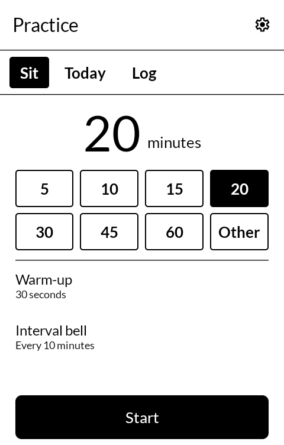
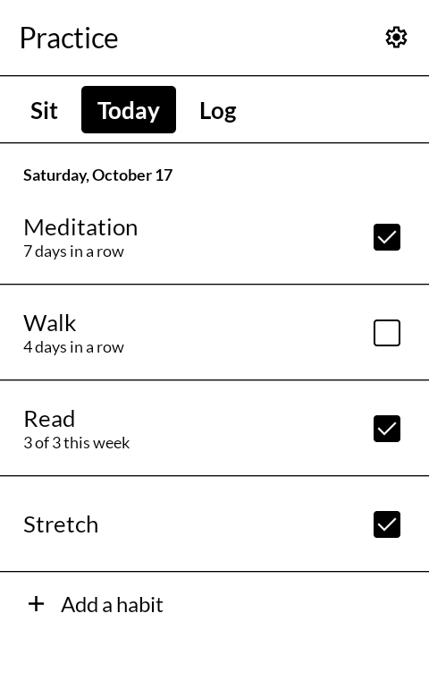
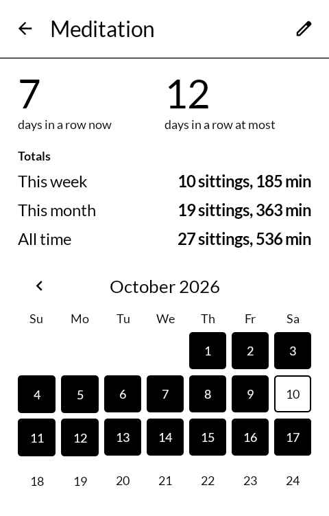
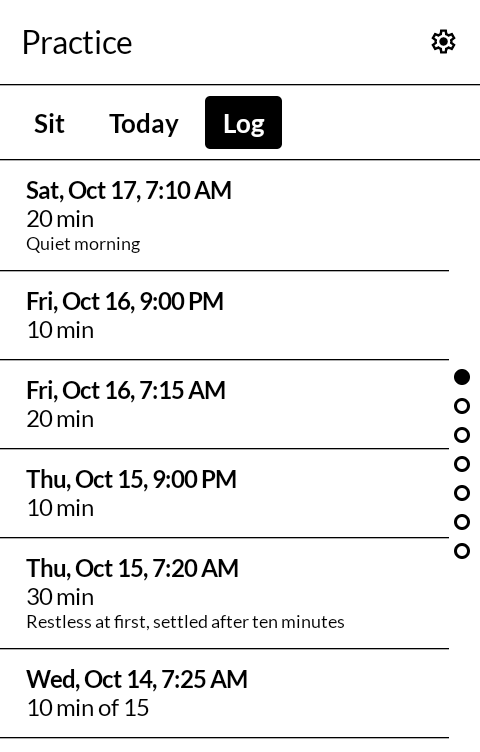

# 日課 nikka — Practice

A meditation timer and a habit tracker in one. Sit for any length, with a warm-up and an
interval bell if you want them; every sitting is logged, and it ticks meditation off for the
day. Beside it, the habits you name yourself, each ticked daily or a few times a week, with a
streak, a month of days and totals for each. Built for the
[Mudita Kompakt](https://mudita.com/products/kompakt/), and it will install on any Android 12
device.

*Nikka* is 日課 — the day's practice, the thing you do every day.

Written from scratch in Kotlin and Jetpack Compose, using Mudita's own
[MMD](https://github.com/mudita/MMD) design system so it looks like the apps the phone already
ships with.

| | |
|---|---|
|  |  |
|  |  |

## Sitting

- **Any length.** Seven presets from 5 to 60 minutes, or **Other** for anything up to ten hours.
- **A warm-up** of up to two minutes before the first bell, to settle. **An interval bell**
  every 5 to 30 minutes, if you want one. One strike of the bowl as the sitting begins and at
  each interval, three at the end.
- **The bells ring on the alarm stream**, so the alarm volume sets how loud they are. They ring
  with the media volume down and with the ringer silenced. **Settings → Try the bell** plays
  one.
- **The screen goes dark while you sit**, its light turned down, and nothing on it changes, so
  the panel is not redrawn until the sitting ends. It turns itself off as it always would.
- **The bells come on time with the screen off**, in Doze, and after the app has been stopped:
  each one is an exact alarm, and the end bell is an alarm clock, which Doze always lets
  through. A quiet notification says when the sitting ends.
- **Hold anywhere to end early.** A sitting ended early is still logged, for the time actually
  sat. **Back** leaves the sitting running.
- **Do not disturb while sitting**, in Settings, turns on alarms-only Do Not Disturb for the
  length of each sitting and puts it back afterwards. It needs the phone's permission once.

When a sitting ends you see how long it was, the streak it keeps, and a field for a one-line
note.

## Habits

- **Today** lists every habit with a box for today. Meditation is ticked by any sitting, not by
  hand; the others are ticked with a press.
- **Every day, or some days a week**: a habit meant three times a week is kept when it is done
  three times between one week and the next, on whichever days. The week starts on the day
  the phone's language starts it.
- **A press on a habit opens its history**: the current streak and the longest, totals for this
  week, this month and all time, and a month of days as squares, filled for done and outlined
  for not. Earlier months are a press away. A past day can be ticked from there, for the day
  you forgot.
- **Meditation's history** adds the sittings and minutes in each total, and the minutes sat on
  each of the last seven days as plain black bars.
- A streak counts in days for a daily habit and in weeks for the others. Today not yet done
  does not break a daily streak until the day is over, and this week not yet kept does not
  break a weekly one until the week is.

## The log

Every sitting, newest first: when it began, how long it was, how long it was meant to be when
it ended early, and its note. A press opens it to change the minutes or the note, or to delete
it, which asks for a second press.

## Backup

**Settings → Save a backup** writes habits, ticks and the log as one JSON file, wherever you
choose through the phone's file picker. **Restore from a backup** reads one back and replaces
everything in the app, after a second press. There is no other copy: Android does not back the
app up.

## One step on a Kompakt

The Kompakt's DuraSpeed setting can shut down apps a few minutes after the screen goes dark,
and an app shut down that way has its alarms cancelled. A sitting runs as a foreground service
for its whole length, but to be sure of the bells, Settings has a row on a Kompakt: **Open
DuraSpeed**, tap **Open** there, switch Practice on in the list, and press **It's switched
on**. If DuraSpeed stops the app again later, the row comes back.

## What it does not do

- **Nothing leaves the phone.** The app has no internet permission. See
  [PRIVACY.md](PRIVACY.md).
- **The phone's alarm icon shows while a sitting runs**: the end bell is set as an alarm clock,
  the kind of alarm that rings on time whatever the phone is saving power for.
- **No charts that need colour.** Everything is black on white: filled and outlined squares,
  and black bars.

## The bell

The bowl is synthesised for this app by [`tools/make-bowl.py`](tools/make-bowl.py): four
partials of a singing bowl, each a pair of tones a fraction of a hertz apart so it shimmers as
a real bowl does, each dying away at its own rate, struck softly. There is no recording, so
there is no one else's sound to credit or licence; it is part of this program and under its
licence.

## Building

```
./gradlew assembleDebug
```

A release build needs a keystore at `signing/signing.keystore` with a matching
`signing/signing.properties`. There is no fallback key in this repository: without one, a
release build comes out unsigned rather than wrongly signed.

`./gradlew testDebugUnitTest` runs the tests of the streaks (daily and weekly, across months,
years and an unfinished day or week), the month grid (from Monday and from Sunday, four to six
rows), and the bells' timing.

## Getting it, and keeping it

Download <https://github.com/wanderwildwood/nikka/releases/latest/download/nikka.apk>
and sideload it. That address always points at the newest release, and every release
publishes a `.sha256` beside the APK if you would rather check than trust.

For updates without doing this by hand, add this repository to
[Obtainium](https://github.com/ImranR98/Obtainium):

    https://github.com/wanderwildwood/nikka

## Licence

GPL-3.0-only. See [LICENSE](LICENSE).

Copyright (C) 2026 wander wildwood

This program is free software: you can redistribute it and/or modify it under the terms of the
GNU General Public License as published by the Free Software Foundation, version 3.

This program is distributed in the hope that it will be useful, but WITHOUT ANY WARRANTY;
without even the implied warranty of MERCHANTABILITY or FITNESS FOR A PARTICULAR PURPOSE. See
the GNU General Public License for more details.

You should have received a copy of the GNU General Public License along with this program. If
not, see <https://www.gnu.org/licenses/>.

Icons are from Material Symbols, Apache 2.0. The bowl sound is made by this program's own
script and is under its licence.
